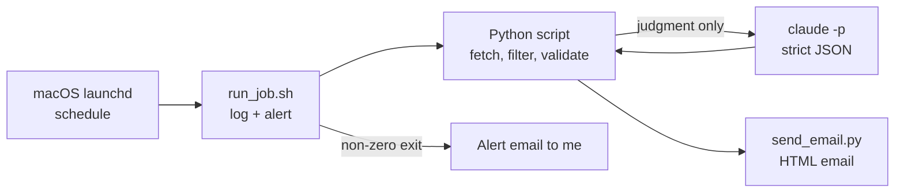

# claude-automations

Three personal automations that run on my Mac every day, built by directing
**Claude Code** and run by macOS's own scheduler, with **Claude** doing the parts
that need judgment:

| Automation | Schedule | What a script does | What Claude does |
|---|---|---|---|
| **Morning briefing** | Daily 7:58 AM | Weather and alerts (National Weather Service API), sunrise/sunset and first/last light (calculated), my calendar (read-only) | Nothing — no AI needed, so none is used |
| **Job search** | Daily 8:00 AM | Sweeps ~280 company job boards through their public APIs, filters by title, location, travel and age, dedupes against what I've seen and applied to | Reads my profile and the shortlist and decides keep/skip, with a one-line reason each |
| **Fuel prices** | Mondays 8:15 AM | Validates the prices, keeps a history, flags anomalies, computes savings per fill for two vehicles and whether the detour is worth it | Fetches three station prices (the source blocks plain scripts) |

Each one ends in a styled email. If anything fails, I get an alert email with the
end of the log.

**Live page:** [deuber.github.io/claude-automations](https://deuber.github.io/claude-automations/)

## How it fits together



- **Scheduling:** `launchd` LaunchAgents. A job missed while the Mac sleeps runs on wake.
- **Claude:** `claude -p` (Claude Code in headless mode) on my Claude plan. The
  job-search ranking gets **no tools at all**; the price fetch gets **only** the
  web-fetch tool. Both must answer in a fixed JSON shape that the script checks.
- **Email:** a small Gmail sender with a dedicated account. The app password lives
  in macOS Keychain and is read at send time, never stored in a file.

## Design choices

1. **Use AI only where it adds judgment.** The briefing is pure code. Weather, sun
   times and calendar formatting don't need a model, so nothing can be rate-limited,
   discontinued, or hallucinate an event.
2. **Give the model a narrow job and a strict contract.** For the job search,
   Claude sees my profile and a short list and returns
   `{"decisions": [{"url", "decision", "note"}]}`. Every candidate must be
   accounted for; anything missing stays in the log, marked unranked.
3. **Validate before acting.** Fuel prices must be present and within a plausible
   range before anything is written to the history or emailed.
4. **Always leave a result.** The job-search script writes an unranked log
   *before* Claude runs, and emails it even if the ranking fails.
5. **Fail loudly, to me only.** One wrapper logs every run and emails an alert
   on any failure.
6. **Test through the real path.** macOS grants calendar access per launching
   app, so a run from Terminal and a scheduled run behave differently. Every job
   was tested with a one-time scheduled run, not just from the terminal.

## Bugs caught by testing

| What | How it was caught |
|---|---|
| Calendar showed "No events" on a day with an event | Compared the scheduled run's output to the real calendar; the calendar tool's separator option takes a delimiter first |
| A failed job would not have sent its alert | A deliberate failing test job: `exit` inside a `{ }` block ended the whole script |
| A silent calendar failure would read as "No events" | Known-answer test with a tool that fails without output |
| Sun times off by an hour on daylight-saving days | Checked every day of two years against an independent astronomy library |
| A travel filter skipping "travel booking systems" roles | Known-answer sentences, then a scan of 352 real postings |

## How I worked with Claude Code

- **Diagnose before fixing:** root causes with evidence (logs, transcripts,
  macOS permission logs) before any change.
- **Known-answer tests:** every calculation and filter was checked against cases
  where I already knew the right answer.
- **Small, reviewable changes,** tested on copies first; real emails only to me.
- **Verify the outcome, not the report:** the inbox and the logs, not
  "succeeded".

An earlier version ran on a self-hosted AI agent with free models. Two of those
free models were discontinued within two weeks, and rate limits hit most mornings
in between, so I moved the judgment steps to Claude and the scheduling to macOS.

## Repo structure

```
docs/index.html            The live page (GitHub Pages)
examples/                  Sanitized copies of the real scripts (placeholders for
                           addresses, location and station IDs)
  send_email.py            Gmail sender: Markdown -> styled HTML, Keychain password
  run_job.sh               Wrapper: log every run, alert on failure
  run_briefing.py          Morning briefing (no AI)
  run_jobsearch.py         Prefetch -> claude -p decisions -> record -> email
  run_gas.py               claude -p fetches prices -> validate -> compare -> email
  launchd/                 Example LaunchAgent schedules
```

The examples depend on helper scripts that aren't published (the job-board
prefetch, the price comparison, and my profile), so they're for reading, not
running as is.
